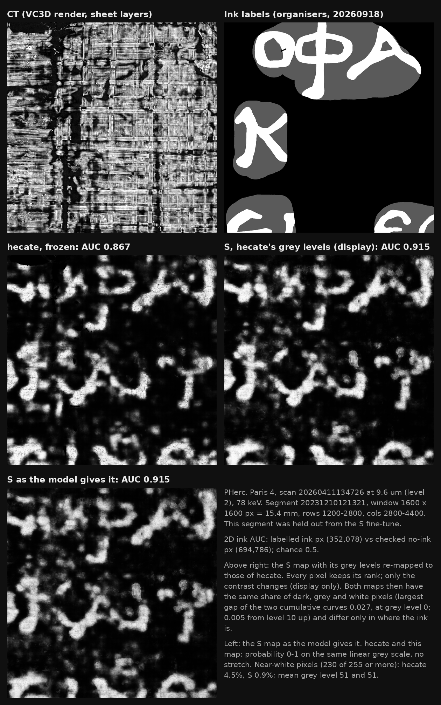
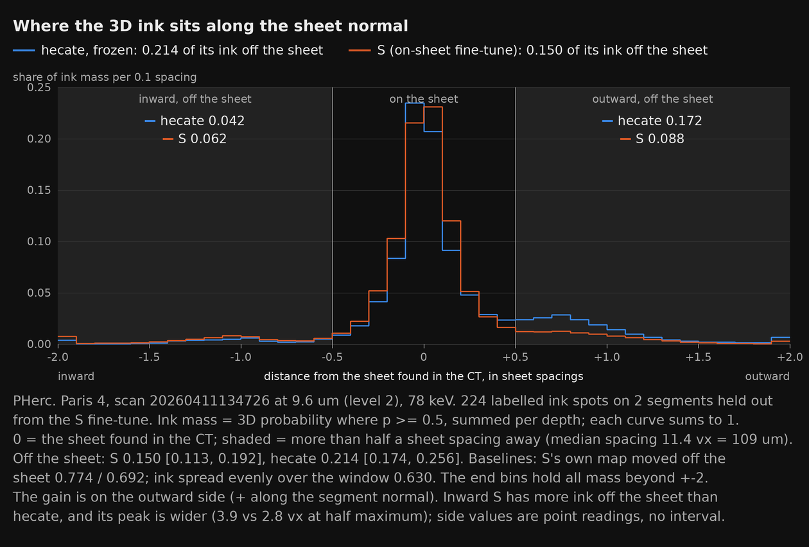

# hecate-onsheet (S): hecate fine-tuned to keep its 3D ink on the papyrus sheet

S is a fine-tune of the public 9.6 µm 3D ink model [hecate](https://huggingface.co/scrollprize/hecate). hecate
predicts ink in 3D around a segment, but part of that ink sits above and below the sheet. S was trained so that
its 3D ink sits on the sheet, with the sheet position taken from the CT, not from the mesh. Its 2D ink map is
made the same way as hecate's (same code, same `predict`), so S can stand in for hecate wherever hecate runs.

- **In:** a tifxyz segment and a CT volume at 9.6 µm (here: PHerc. Paris 4, from the public bucket).
- **Out:** a 2D ink probability map (uint8 PNG / npy) for the segment window, and the 2D AUC of hecate and S
  against the organisers' ink labels.
- **Wall time:** one 15.4 mm window, about **4 min** end to end on one RTX 5090 (247 s: download ~1 min, VC3D render,
  two models, score; `results/f636_fresh_clone_release_tree.json`, `readings.wall`).
- **Download:** 1.6 GB in total. The script fetches 1.1 GB: 0.6 GB of CT chunks (`results/f636_fetch.json`, `gb`)
  and hecate's checkpoint (0.52 GB, 522 576 086 bytes). The S checkpoint (0.52 GB, 522 573 195 bytes) you fetch
  yourself.



Read the figure with care: hecate's map has more near-white pixels than S's (4.5 % against 0.9 % at grey level 230
or more; the mean grey level is the same, 51 of 255), so side by side hecate looks clearer at a glance although
its AUC is lower. The middle right panel therefore shows the S map with its grey levels re-mapped to hecate's
(display only: every pixel keeps its rank; 2D AUC 0.915 before and after). The bottom left panel is the S map as
the model gives it. The re-mapping is not exact at pure black: 2.7 % of the pixels are black in hecate's map and
one grey step above black in the re-mapped one; from grey level 10 up the two distributions differ by at most
0.005. File: `results/f636_figure_display.json`.

## Run it

Code: https://github.com/jo-tud/hecate-onsheet. Weights: the file `hecate_onsheet_S.pth` on https://huggingface.co/jo-tud/hecate-onsheet (CC BY-NC 4.0).
Clone the code, download the weights file, then run this block inside the clone:

```
python3.12 -m venv .venv && . .venv/bin/activate
pip install -r requirements.txt --extra-index-url https://download.pytorch.org/whl/cu130
export VC3D_IMAGE=<docker image with /opt/vc3d/bin/vc_render_tifxyz>   # or: export VC_RENDER_BIN=/path/to/vc_render_tifxyz
PYTHON=python bash run_window.sh out/ path/to/hecate_onsheet_S.pth
python figure/make_figure.py out/ out/figure.png    # writes figure.png and figure.json into out/; the tracked figure.png stays as it is
```

**You bring the renderer.** This tree does not ship VC3D and has no default for it: `run_window.sh` stops before
any download, with a message that names the two variables, unless `VC3D_IMAGE` or `VC_RENDER_BIN` is exported.

`run_window.sh` runs the five steps of `onsheet.py` (`prep`, `fetch`, `render`, `infer` × 2, `score`). Each step
can run alone; `--seg`, `--r0`, `--c0`, `--size` pick another Paris 4 segment or window (default: the reference
window below). `prep` builds the 9.6 µm segment (every 4th node of the public 2.4 µm mesh, coordinates
`(p − 1.5) / 4`) and the labels (`inklabels` and `supervision` at level 2; ink = ink ∧ supervised, no ink =
supervised ∧ ¬ink). `render` calls VC3D `vc_render_tifxyz` with 16 layers 1 voxel apart. VC3D steps along the
negative normal, so `infer` flips the stack (VC3D layer j = plane 15 − j) before the model sees it; without the
flip the model reads the sheet upside down. `score` gives the 2D AUC (labelled ink px vs checked no-ink px, all
mesh-valid px of the window) and, on the reference window, compares it with the stored numbers: verdict `REPEATS`
(both models within ±0.005 AUC) or `DIFFERS`. On `DIFFERS`, `score` and `run_window.sh` end with a non-zero exit code.

The S checkpoint is not in git. It is the file `hecate_onsheet_S.pth` (522 573 195 bytes) on
https://huggingface.co/jo-tud/hecate-onsheet (CC BY-NC 4.0). `onsheet.py` checks its sha256
(`4b84fdf2…05b4f2`) and hecate's (`809f4f10…fcfe5d`, `hecate.py` `c232c18a…b8da59`, both downloaded from Hugging
Face at revision `9cb86e50`).

## Run S in ink-sdk

S also runs in the public [ink-sdk](https://github.com/LimeGS/ink-sdk) (MIT) from a copy of its `hecate@9.6um`
profile with 6 changed lines. On the reference window the ink-sdk map is the same as this tree's S map: Pearson r
0.999999, every pixel within 1/255, 98.9 % of the pixels byte-equal. Frozen hecate through the same call: r 0.999999.
Baseline: the map of the other reading direction has r 0.134 with the S map. File:
`results/f639_ink_sdk_same_map.json` (`pairs.S`, `pairs.PC2`, `pairs.S.r_cross`).

```
git clone https://github.com/LimeGS/ink-sdk && git -C ink-sdk checkout 2df3ab50 && pip install -e "./ink-sdk[hecate,fetch]"
mkdir -p profiles models/s && cp path/to/hecate_onsheet_S.pth models/s/hecate_onsheet_S.pth
cp ink-sdk/src/ink_sdk/profiles/hecate-9.6um.toml profiles/hecate-onsheet-s.toml
# edit profiles/hecate-onsheet-s.toml:
#   id = "hecate-onsheet@s"
#   [checkpoint]  path = "s/hecate_onsheet_S.pth"      upstream_path = "hecate_onsheet_S.pth"
#                 sha256 = "4b84fdf2f90cb369b254f04415d474bac8ab087a47022badd2d20fa32205b4f2"      bytes = 522573195
#   [execution]   direction = "both"
export INK_SDK_PROFILES=$PWD/profiles INK_SDK_MODELS=$PWD/models
ink-sdk doctor                                       # [verified] hecate-onsheet@s; its other profiles show [missing], as expected
python -c "import numpy, zarr; numpy.save('render16.npy', zarr.open_group('out/render.zarr', mode='r')['0'][:])"
ink-sdk infer -p hecate-onsheet@s --surface-volume render16.npy --pixel-um 9.6 --out runs/s
# the S map of this tree = runs/s/probability_reverse.npy
```

- **Set `direction`.** A copy that changes only the checkpoint reads the sheet from the other face (r 0.134 with
  the S map, `pairs.S_ckpt_only`): ink-sdk's default is `forward`, and `onsheet.py` reverses a VC3D stack before the
  model sees it. With `direction = "both"` the S map is `probability_reverse.npy`.
- **What was tested:** ink-sdk at commit `2df3ab50` installed from a clone, fp32, one window (the reference
  window), the 16-layer `vc_render_tifxyz` stack of `run_window.sh` given as a `.npy` file. **Not tested:** `render.zarr` given directly, ink-sdk's own render (`--tifxyz`),
  bf16, other windows. `ink-sdk fetch` cannot download S (the copied `[source]` block still names hecate).
- You still need a render of your segment, so the VC3D limit below stays.

**A ready profile.** The model page also holds `hecate-9.6um-onsheet-s.toml`: the same settings as a finished
ink-sdk profile (id `hecate@9.6um-onsheet-s`; `direction = "both"`, `primary = "reverse"`, the weights file pinned by
size and sha256). With it no line is edited by hand, `ink-sdk fetch -p hecate@9.6um-onsheet-s` downloads the weights,
and the S map is `runs/s/probability_primary.npy`. Its run block is on the model page (`MODEL_CARD.md` in this
tree). Tested like the copy above, with the profile built into ink-sdk `2df3ab50` and the weights already on disk:
Pearson r 0.999999 with this tree's S map, every pixel within 1/255, 98.9 % of the pixels byte-equal; the forward
map of the same run has r 0.134 (`results/f4015_ink_sdk_profile.json`, `C3`). `ink-sdk fetch` and the download of
the profile file were run with the model page still private (owner's login). **Not tested:** both without a login.

## Results

All on PHerc. Paris 4, scan 20260411134726 (2.4 µm, 78 keV) read at 9.6 µm (level 2), labels release 20260918.
S was fine-tuned on 4 of the 8 labelled segments; every Paris 4 number below is on the other 4 (**held out** from
the fine-tune). Frozen hecate is the baseline. Its model card says it was developed on the Scroll Prize ink dataset,
with 3D supervision on Paris 4, and it names no held-out segments. We therefore treat hecate as **in-sample** on
these segments; if that is right, the comparison is tilted in its favour.

| what | S | frozen hecate | other baseline | data | results file |
|---|---|---|---|---|---|
| off-sheet share: of the 3D ink (p ≥ 0.5) at labelled ink spots, the share more than half a sheet spacing from the sheet, with the sheet found in the CT (steepest intensity fall along the normal) | **0.150** [0.113, 0.192] | 0.214 [0.174, 0.256] | 0.774 / 0.692: S's own map moved 6–8 vx outward / inward (5 % quantile of 1 000 draws) | 224 fresh ink spots on 2 held-out segments; paired S − frozen −0.064 [−0.088, −0.041] | `results/f561_on_sheet_paris4.json` (`criteria.F1`, `secondary.frozen`, `readings.paired_S_minus_frozen`) |
| 2D ink AUC on the VC3D render, 4 windows of 15.4 mm | **0.940** | 0.918 | chance 0.5 | one window per held-out segment, pooled px | `results/f561_villa_render_4windows.json` (`readings.auc_2d`) |
| 2D ink AUC on the reference window (the figure; repeated by `run_window.sh`) | **0.915** | 0.867 | chance 0.5 | segment 20231210121321, rows 1200–2800, cols 2800–4400 | `results/f581_fresh_clone_one_window.json`, `reference/window.json` |
| guard: ink AUC on PHerc. 0139 (9.362 µm, 113 keV), 3 segments not used in the fine-tune (w035, w039, w041) | 2D 0.799, 3D 0.829 | 2D 0.789, 3D 0.837 | bar set before the run: frozen − 0.03 | 119 ink / 113 no-ink spots; **in-sample for frozen**, dev for S | `results/f524a3_training_run_and_0139_guard.json` (`readings_0139.R.guard` = S, `readings_0139.frozen.guard`) |

**Which key is S.** The results files keep their working names, and the key `R` does not mean the same model in
every file:

| file | S is | `R` is |
|---|---|---|
| `f524a3_training_run_and_0139_guard.json` | the key `R` (the file's `arm_note` says so) | S |
| `f561_on_sheet_paris4.json`, `f555_on_sheet_paris4_first_draw.json` | the key `S` (`judged`: S; `criteria`) | another fine-tune, not released (`secondary.R`) |
| `f564a2_fail_public_arena_0139_0841.json` | not in the file | the model trained on PHerc. 1667 (`judged`), not S |

The off-sheet share and the 0139 guard were scored with our internal scorer; that code is not in this tree. The
2D AUC is computed by `onsheet.py score`. 95 % intervals are bootstrap over spots.



**Where the gain is.** This is the first row of the table drawn per depth: the 3D ink mass of both models at the
same 224 spots, by distance from the sheet (`results/f561_depth_profile.json`, made from the stored outputs of the
scored run with our internal scorer). `python figure/make_depth_panel.py out/figure_depth.png` draws it from that
file; it sums the bins of the two shaded zones and stops if they do not give the scored 0.150 and 0.214. The gain is
on the outward side: there 0.088 of S's ink mass lies off the sheet, against 0.172 for frozen hecate. On the inward
side S has more than frozen hecate (0.062 against 0.042), and S's peak on the sheet is wider (3.9 against 2.8 voxels
at half maximum). These per-side values and the width are point readings with no interval. "Outward" and "inward"
are the positive and the negative side of the segment normal (the keys `out` and `in` of the results files). The two
end bins of the figure also hold all mass beyond ±2 sheet spacings.

## Limits and named fails

- **One scroll.** The on-sheet result is on PHerc. Paris 4 only, one seed, one checkpoint. The 4 held-out
  segments are new segments for S, but the off-sheet spots lie on 2 of them.
- **It did not carry over to a public scroll.** Fine-tuned the same way on 4 PHerc. 1667 segments and scored on
  2 held-out ones, the off-sheet share was 0.107 vs frozen 0.119, paired difference CI [−0.036, +0.012]: no
  improvement shown (frozen hecate was already on the sheet there). On PHerc. 0139 w045 + three PHerc. 0841
  segments, where frozen hecate leaks, that model moved ink towards the sheet (−0.049 [−0.081, −0.016]) but its
  2D AUC fell from 0.896 to 0.854. Files: `results/f564_fail_1667.json`,
  `results/f564a2_fail_public_arena_0139_0841.json`.
- **The fine-tune's first bar failed.** In the mesh frame (sheet = mesh) the off-sheet share of S stayed above
  the bar we had set (`results/f524a3_training_run_and_0139_guard.json`, verdict FAIL), because the mesh itself
  lies a few voxels off the papyrus. The on-sheet result above is in the CT frame, a bar set after that fail and
  tested on two fresh spot draws (0.144 and 0.150; `results/f555_on_sheet_paris4_first_draw.json`, `criteria.F1` there).
- **The gain is on one side, and the peak is wider.** S removes ink that lies outward of the sheet. Inward of the
  sheet it has more ink off the sheet than frozen hecate (0.062 against 0.042 of the ink mass), and its peak on the
  sheet is wider (figure and file under "Results"). These are point readings with no interval.
- **An outside author's mesh.** On Forrest's public PHerc. Paris 4 ufsm wraps (`ufsm-c2f-20261030`) the gain is
  measured only where that mesh lies within 3 vx of an organiser mesh, on patches resampled to 1 px = 1 vx:
  off-sheet share 0.221 against 0.258 for frozen hecate, paired −0.037 (95 % CI −0.055 … −0.017), 225 labelled
  spots on 17 wraps; 2D AUC 0.900 against 0.886 (`results/f647_forrest_wraps.json`: `A.H1`, `A.leak.maps`,
  `A.auc2d`). It is not measured away from organiser meshes: his wraps with no organiser segment under them could
  not be scored. Inside the sheet S's ink is not narrower than hecate's.
- **2D AUC is pixel-level** (labelled ink vs labelled no-ink), not a letter-reading test. No new text is claimed.
- **Training is not runnable from this tree.** `train/` holds the exact training code (see `train/README.md`),
  but the training blocks it reads are built by internal prep scripts that are not here.
- **VC3D.** We render with villa `vc_render_tifxyz` (GPL-3.0, not in this tree) at commit 47111d1a in a local
  docker image; we have not tested other VC3D builds. The render matched our own trilinear sampler at Pearson r 0.998 on all 4 windows.
- GPU and driver changes can move the last bits of a map; the repeat bar is ±0.005 AUC.

## Credits

- hecate and the canonical 2 µm ink detector: Vesuvius Challenge (Hugging Face `scrollprize/hecate`,
  `scrollprize/ink_canonical_2um`, MIT).
- VC3D `vc_render_tifxyz`: ScrollPrize/villa, folder `volume-cartographer/`, **GPL-3.0** (villa's root licence is
  MIT; VC3D's own is GPL-3.0). We call it as a separate program and ship none of it; our code stays MIT.
- CT, segment meshes and the 20260918 ink labels of PHerc. Paris 4 and PHerc. 0139: Vesuvius Challenge open data
  (CC BY-NC 4.0).
- The outside-mesh check uses Forrest's public PHerc. Paris 4 ufsm wraps (`ufsm-c2f-20261030`, community uploads).

## Licence

Code: MIT (`LICENSE`). S weights: CC BY-NC 4.0, with hecate's MIT notice (`THIRD_PARTY.md`, which also lists the
licence and source of every input). PHerc. Paris 4 results may appear in prize entries and public repositories;
they may not go into journal or conference publications before 2027-06-25 (organisers, 2026-11-09).
